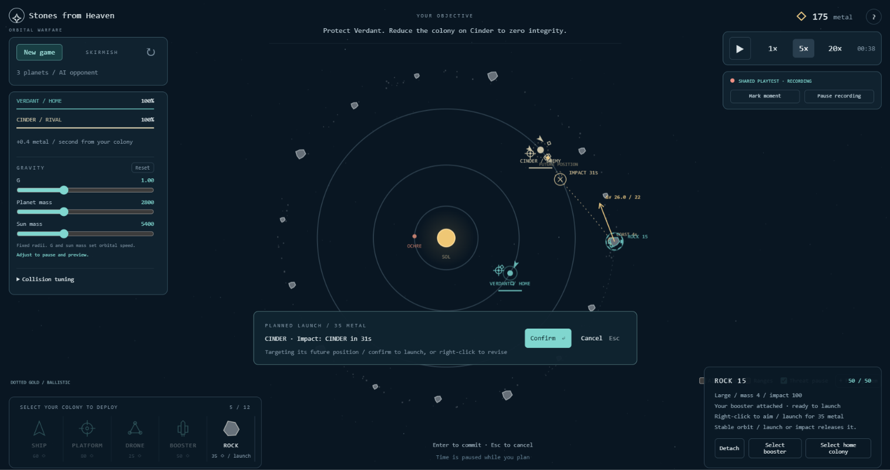

# Stones from Heaven: Orbital Warfare

**Turn asteroids into weapons. Bend their paths around planets. Defend your little corner of space.**

*Plan a shot at a moving planet, review its predicted path, then let it fly.*

For the latest development checkpoint and pending work, see [HANDOFF.md](HANDOFF.md).

A quiet, playable planetary warfare game. All visuals are procedural Canvas 2D; the game uses no runtime packages, external assets, accounts, or services.

## Play

On GitHub, choose **Code > Download ZIP**, extract the ZIP, open the **dist** folder, and double-click **index.html**. Use the file inside `dist`, not the source file at the repository root. No Node.js, package installation, account, or server is needed to play.

The built game is self-contained and works offline in a modern browser. Windows Chrome is tested; macOS/Safari has not yet been verified. Every scenario starts paused.

For development, run `npm start` and visit http://localhost:3000. On Windows PowerShell, use `npm.cmd start` if the PowerShell script policy blocks the npm shortcut. The local server only serves files; there is no game backend.

Run `npm run build` after source changes to refresh the standalone copy. Building and running the game require only Node.js, with no package installation.

## Controls

Untouched asteroids stay on stable circular belt orbits. Launching releases them into gravity-driven flight with their current tangential velocity; a collision with a flying rock also releases the struck rock. Waiting rocks do not collide with one another. Previews and booster rendezvous use the same rules. The belt is 25% farther out, at radii 1025-1070; Fit system includes its full extent.

Choose **Start tutorial** on the welcome screen for guided Rock Garden instructions, or **Explore freely** to begin without guidance. Step zero explains selection and right-click orders and highlights the contextual unit panel. The tutorial starts with only your booster and an undefended colony. After the first launch, select the spent booster, right-click Verdant, confirm its return, and wait for the free eight-second refuel. Then send the first practice rock and watch it cause real colony damage. A 190-metal grant then funds a platform, two drones, and a ship. Launch a matching practice rock to see your new defenses intercept it, then use the ship to destroy the enemy booster. The final lesson restores Ochre as a 240-integrity enemy colony with two platforms and three ramming drones. A one-time 500-metal grant helps you build up to two boosters and three ships. Prepare two rocks, launch a coordinated volley, and attack with your ships; reload, rebuild, and repeat if needed. Destroy Ochre to complete the tutorial. Magenta guidance advances with your actions; you can skip without resetting. Free exploration retains its starting fleet. Run `node tests/tutorial-browser.mjs` to verify the complete guided flow.

Navigation and scrollable scenario details/tuning form the left column. Playback controls and optional shared-playtest recording form aligned panels on the right; the recording indicator dims when paused.

Opening or refreshing the game shows **Welcome to Stones from Heaven**. Choose **Start tutorial** for guidance or **Explore freely** to dismiss it; Rock Garden stays paused, with no second dialog. The outlined navigation area at the upper left contains the **Scenario** dropdown for arranged missions and **New game** for Scenarios, Skirmish, and Sandbox. Choosing a scenario or starting/restarting a game still shows its briefing.

- With an equipped rock selected, hold right-click in empty space and drag to continuously adjust its trajectory preview. Release to keep the preview, then confirm to launch; Escape cancels. Starting a right-click on a planet still calculates an automatic shot.
- Left-click a combat ship, booster ship, platform, drone, planet, or large belt rock to select it. Click the selected object again, or click empty space, to clear selection. Dragging empty space pans without clearing selection.
- Right-click a point or target to plan a ship order. Moving planets are tracked automatically. Enter confirms; Escape cancels. Planning pauses time.
- Right-click gives the selected object's contextual order; the cursor hint names it. Combat ships attack enemies, escort friendly mobile units, defend friendly planets/platforms, and move to empty space. Boosters attach to free rocks and return to friendly colonies to reload. Drones defend friendly planets/platforms and retain their bounded interception behavior.
- Select a free belt rock and choose **Send booster**, or select a loaded booster ship and right-click the rock. Confirm and unpause. The ship travels to the rock, matches its velocity, and attaches over six seconds. Its countdown is visible on the map and in the selection panel.
- Select a rock equipped with **your** booster and right-click a planet to calculate a shot toward its future position. Arrival windows within 90 seconds are checked first; if those fail, the solver also tries 105 and 120 seconds. If no impact is verified within the impulse limit, confirmation stays disabled: choose another target, aim manually, or cancel and wait. This means the search found no verified shot, not that every possible trajectory is impossible. Right-click empty space to preview a manual velocity change; legacy drag aiming also works. Enter confirms and Escape cancels. A launch costs 35 metal, with an impulse limit of 26 units/second. Untouched or enemy-equipped rocks cannot be launched.
- Booster ships are unarmed and carry one booster each. Clicking either member of an attached pair selects the rock for aiming. **Select booster / Select rock** in the selection panel switches which object you control. With the booster selected, right-click empty space to detach and move, or a friendly colony to detach and return for an eight-second free reload. These orders require confirmation; cancel leaves the pair attached. During a four-second launch burn, travel orders wait until the burn finishes. With no departure order, the booster separates automatically and waits. **Detach** also offers separation without travel before launch. Detaching before launch keeps the charge for another rock. Rocks require a living, loaded attached ship to launch.
- Select a combat ship and right-click a friendly booster ship to escort it. Right-click an enemy booster to attack it. Destroying a booster before it finishes attachment prevents that shot; equipped enemy rocks can also be destroyed before launch.
- Attacking an enemy unit closes the distance, then circles the moving target inside weapon range while prioritizing it on every firing cooldown. This applies to boosters, ships, drones, and platforms, for both factions. Circles tighten near planets; ship orders return to Stop when their target disappears. A new order replaces the pursuit. Planet bombardment and bounded drone defense retain their existing behavior.
- Space pauses or resumes. The 1 / 2 / 3 keys select 1× / 5× / 20×. Clicking a speed resumes time.
- Scroll to zoom at the pointer. Drag empty space or use the middle mouse button to pan. F fits the system.
- Select your home colony to deploy combat ships (60), platforms (80), drones (25), booster ships (50), or miners (25). Your colony earns 0.8 metal per simulation second. Each faction has a 12-unit fleet limit, including boosters and miners.
- Damaged combat ships repair for free at **1 health per simulation second** within 100 units of their own home planet's surface, after **10 seconds without taking damage**. Both factions use this rule; new gunfire or ram damage restarts the delay. Leaving the area pauses healing, and a destroyed or enemy-owned home cannot repair the ship. The selected ship panel shows cooldown, active repairs, or return-home guidance. Repairs apply to Basic and Super combat ships, up to their maximum health; other unit types do not regenerate.
- Combat ships attacking rocks, including rocks acquired while defending, seek entry into weapon range rather than a docking rendezvous. They brake once comfortably in range instead of matching the rock's speed; fleeing rocks can still be pursued. Their short interception estimate updates continuously, with normal thrust and obstacle avoidance. This applies to both factions and the preview; booster/miner docking and ship-versus-ship circling use their existing rules.
- Select a miner, right-click an idle asteroid, and confirm. After reaching it and docking for four seconds, it earns 0.8 metal per second directly into the treasury, with no hauling. Each rock has a finite metal reserve: small 40, medium 80, large 160. The selected-object panel shows remaining metal. Depletion stops income; the miner stays docked until reassigned, and the empty rock can still be launched with unchanged impact damage. A full treasury pauses extraction without wasting ore. Only one miner can dock per rock. Miners are unarmed, with 65 health and cruising speed 30; they slow down to match asteroid velocity before docking. Right-click another destination to leave. Launching a mined rock releases the miner and ends income; destruction of the rock kills a docked miner. Select a warship and right-click a friendly miner or other friendly unit to escort it and engage nearby enemies. Skirmish opponents can build and use miners under the same rules.
- Ships, platforms and drones have **Basic** and **Super** versions. Select an individual unit and use **Upgrade to Super**; the panel shows price and stat changes before buying. Ships cost 25 metal to upgrade (145 health, speed 26, range 130, damage 12, 1.8-second cooldown); platforms cost 32.5 (300 health, range 170, damage 16, 1.5-second cooldown); drones cost 10 (speed 42, defense area 240, ram damage 70). Damage is preserved as a percentage of health, not repaired for free. Upgrades apply once to that unit and do not improve future builds. Super units and beams use a darker planet color, with double chevrons on units and thicker beams. The Skirmish opponent pays the same upgrade costs. No technology tree.
- Drones are ramming interceptors: no gun, 45 contact damage, and consumed on impact. They attack incoming rocks and hostile ships, drones, or boosters within 180 units of their assigned planet/platform. If the threat leaves, surviving drones return home. Platforms remain durable, reusable guns with 135-unit range. The Ranges toggle shows the drones' defense area around their host; charging drones fill in and leave a short thrust trail. Both factions follow these rules.
- The field guide (`?`) explains these controls in the game.

The system places planets on radii of approximately 202, 463, and 820 units, with the asteroid belt at 1025–1070. The outermost planetary orbit is 80% of the belt's inner radius; inner lanes are spread proportionally. Planetary speed still derives from gravity and orbital radius. Smaller planet bodies and stronger planetary gravity create visible flyby curves with room to avoid impact.

The compact **Gravity** controls below the colony panel work in every mode: **G** scales all gravity, **Planet mass** sets the same mass for every planet, and **Sun mass** controls the central star. Effective G is `12 * slider G`: default 1.0 now matches the previous build at slider 2.0. Fresh belt rocks and planets use matching orbital speeds (sqrt(2), about 141.4%, of the preceding baseline), with unchanged orbital radii and visual scale. Acceleration follows `effective G * attracting mass / distance²`, softened close to bodies; units do not attract one another. Defaults are G = 1, planet mass = 2800, sun mass = 5400 in game units. Sliders range from zero to three times each default. Planet mass no longer depends on its visual radius.

Adjusting a slider pauses time and updates paths and incoming-threat forecasts without changing current positions, orders, or metal. Planets keep their orbital radii, but their speed is now `sqrt(effective G * sunMass / radius)`: increase G or sun mass to orbit faster, or set either to zero to stop planetary motion. Planet mass does not affect their own speed with the sun fixed. Platforms inherit the change in their host's velocity while retaining their local orbit rate; free-flying ships and rocks keep their existing velocities. A pending launch keeps its chosen impulse; if a targeted shot no longer hits, confirmation is blocked until you re-aim. **Reset** restores default gravity without restarting. Restart keeps your tuning; New game starts with defaults. Both factions use the same gravity, including enemy launch calculations. Assisted ships compensate for 90% of gravity separately from their maneuvering thrust limit, keeping steering usable in the stronger fields.

Teal dotted paths include autopilot thrust and stop at a marked attachment point. Launch forecasts show the powered segment in teal (coral for enemies), a COAST marker at burn completion, and the remaining ballistic path in gold or coral. When aiming a rock, its gray path shows its unchanged motion. Forecasts run the same fixed-step flight and booster lifecycle code as the simulation, normally 90 seconds ahead and up to 120 for longer targeted shots, including the powered burn, separation, moving planets, and collision detection. Combat and future enemy decisions are excluded, so interception can prevent a predicted impact.

## Rock collisions

Small, medium, and large rocks have masses **1, 2, and 4**, and planet damage **35, 65, and 100**. Their gravitational acceleration is identical. All belts contain a mix of sizes; selection shows size, mass, and damage. Boost costs and impulse limits are unchanged.

Rocks collide regardless of ownership, including unlaunched belt rocks. Glancing hits transfer momentum and lose some rebound energy; hard hits destroy both rocks and attached boosters with harmless visual debris, without simulated fragments. A deflected idle rock becomes a dangerous ballistic projectile. Defenses forecast bank shots as well as direct threats. If a loaded booster survives attached to a deflected rock, detach it manually to recover it.

Open **Collision tuning** below Gravity. **Bounce** ranges from 0 (no normal rebound) to 1 (elastic), default 0.35. **Rock strength** ranges from 1 to 100, default 18; higher values survive harder hits. The threshold compares normal collision energy per combined mass, so glancing hits and unequal masses behave differently. Changes pause, refresh previews, and revalidate automatic shots without changing current motion or a pending impulse. Reset restores defaults; restart/reset range retains tuning, while New game starts at defaults.

Predictions use the same swept collision solver as gameplay. DEFLECT/SMASH markers show contact times; violet secondary paths show affected rocks after contact, including chains. Weapons and future AI decisions remain outside the forecast. Contacts are resolved in time order against rocks, moving planets, and the sun, preventing high-speed tunneling.

## Scenarios

**New game**, at the upper left, separates three ways to play. **Scenarios** are the existing arranged missions below. **Skirmish** is an untimed match against the existing AI, with two or three planets and a shared starting budget of 160, 240, or 400 metal. **Sandbox** uses the same setup choices, with optional enemies and unlimited player metal. Unlimited metal waives deployment and launch costs; booster preparation, damage, colony deployment restrictions, and the fleet limit still apply. Enemy budgets remain finite. Sandbox has no victory or defeat screens, even if a colony is destroyed.

Skirmish colonies start at **300 integrity** for both factions, giving more room to build an economy. Arranged scenarios and Sandbox retain their existing colony integrity. At 0.8 metal/second, a 25-metal miner repays its purchase after **31.25 seconds of active mining**, plus travel and docking. Deposits still hold 40/80/160 total metal, so faster mining also depletes them sooner. Colony income remains 0.8 metal/second.

The top strip shows a labeled Scenario selector (or the open-game mode), the objective and immediate threat summary in the center, and metal/time controls on the right. New game pauses the system; Back or Escape preserves the current run and its pending order. Starting another game replaces the run. Restart retains the selected setup. After winning, **Keep exploring** continues the same live system as a sandbox; use New game for a fresh system.

- **Rock Garden:** start with a booster ship, prepare and launch a rock, then intercept a practice attack. Send practice rock dispatches an unarmed enemy training booster from the marked outer practice dock; it physically prepares an asteroid before launch. Training deployments and launches are free, but still require attachment. Your initial defenders can handle the incoming rock. Ochre is an uninhabited aiming target. Rocks can also damage your own colony; defenses intercept friendly launches predicted to hit home. After the objectives, choose Keep exploring for a sandbox. Use the scenario dropdown in the upper-left to switch missions.
- **Hold the Orbit:** survive four simulation minutes. The enemy attempts up to three booster expeditions, with escorts and a small attacking fleet. Interrupt their preparation or defend against the launched rocks. Arrival times depend on actual travel, attachment, and rearming; destroying a booster can prevent a wave.
- **Neighbors:** destroy the rival colony while protecting your own. Ships bombard in range; small, medium, and large rocks cause 35, 65, and 100 integrity damage. The opponent pays the same deployment and launch costs, earns the same income, and uses the same flight and weapon rules.
- **Slingshot Playground:** test trajectories and planetary defenses. Twelve belt rocks already have friendly boosters attached; launches are free. Verdant is your home, with friendly defenders. Cinder and Ochre are enemy planets. Each world has a ship, a platform, and two drones, colored to match that world. Defenders engage fired rocks but leave waiting equipment alone. There is no time limit, victory screen, enemy production, or counterattack. Your defenders also intercept your own rocks if they threaten home. Select a rock and right-click a planet to aim, or empty space for a manual shot, then confirm. **Next rock** cycles the belt; **Reset range** restores all rocks and defenses while keeping gravity settings. Find it under New game > Scenarios or choose **04 / Slingshot Playground** in the scenario dropdown.

Launched rocks damage any planet they hit, regardless of faction. Defenses intercept friendly launched rocks when a forecast predicts an impact on their own colony, while leaving safe outgoing and unlaunched rocks alone. Ship weapons still avoid friendly ships and colonies. Destroyed rocks create harmless visual fragments. New major threats, including your own dangerous launches, pause fast-forward by default; disable Threat pause to keep time flowing.

## Source and verification

### Shared playtesting

Run `npm run playtest` to open a dedicated Chrome window with opt-in game recording. This uses a separate browser profile and the standalone build; your ordinary game tabs are not observed. Run `npm run build` first after changing the source.

The shared window displays **SHARED PLAYTEST · RECORDING**. Play normally. **Mark moment**, or M, preserves the recorded lead-up to a confusing event. **Pause recording** stops new input and screen capture until you resume. Closing the shared browser ends the session.

While you play, the local helper keeps a rolling history of up to two minutes: screenshots with a cursor overlay, clicks and game shortcuts, accepted/rejected game actions, feedback messages, and full game-state snapshots. Captures are approximately once per second and do not pause the simulation. A screen and its associated state can differ slightly in time; both timestamps are saved. Marked history is copied aside so it survives the rolling buffer.

For the assistant, `npm run playtest:inspect` captures and summarizes the current shared session. Open the returned `screenshotPath` with the image viewer; `snapshotPath` contains full state. Use `npm run playtest:inspect -- --ago=10 --seconds=15` to inspect an earlier frame and the actions leading up to it. Historical output is labeled when the window is closed or recording is paused. Inspecting does not issue game orders or take over the cursor.

Artifacts stay in the ignored `.orbital-playtest/` folder. The inspection helper listens on localhost port 9333 and only captures the dedicated game tab. It does not record microphone audio, desktop windows, other browser tabs, or general typed text. No external service is used. The normal standalone game does not record unless explicitly launched with `?playtest=1`.

`npm run test:playtest` verifies recording, inspection, input results, preserved markers, pause/resume, reload continuity, and separation from normal play.

### Game source

- `src/simulation.js`: fixed 0.05-second physics, autopilot, swept moving-body collision detection, economy, weapons, enemy behavior, and forecasts.
- `src/scenarios.js`: starting systems, fleets, budgets, objectives, and briefings.
- `src/render.js`: camera transforms and procedural drawing.
- `src/input.js`: selection, order planning, asteroid dragging, and camera input.
- `src/orders.js`: the shared contextual action mapping used by right-click handling and cursor hints.
- `src/main.js`: game loop, UI, pause/speed controls, warnings, and scenario lifecycle.

`npm test` runs the Node simulation suite. It checks forecast agreement with actual flight, moving-target pursuit, powered burns, all-faction rock impacts, defensive interception of friendly threats, high-speed collisions, deployment restrictions, interception, bounded drone defense, victory/defeat, restart, and frame-group independence. Booster tests cover launch authorization, rendezvous and attachment timing, persistent attachment before launch, timed burn and automatic separation, manual return/rearming, matching forecasts, escorts, destruction before attachment, and enemy preparation and launch costs.

For browser checks, run `npm install`, start the local server, and run `npm run test:browser`. This uses the installed Chrome at the Windows default path; set `ORBITAL_BROWSER` to another Chromium executable if needed. Set `ORBITAL_URL` to test another URL or the standalone file. Browser checks exercise real mouse/keyboard controls, deployment, order preview/confirmation, rock drag/launch, interception, victory, restart, camera zoom, threat auto-pause, and a mobile-sized layout. Screenshots are saved to `test-results/`.

`npm run test:controls` audits every control in the standalone build. It verifies controls survive changing health, forecasts, selections, and scenarios, then tests held clicks across UI refreshes, keyboard focus, and ship/drone/booster orders while the game runs. Run `npm run build` first when source files change.

`npm run test:modes` checks the New game flow, cancellation without losing orders, sandbox purchases, restart settings, skirmish budgets, continued exploration, threat summaries, and responsive header layout. `npm test` also verifies open-game economy and outcomes. The shared playtest regression includes native system/budget dropdowns during screenshot capture.

`node tests/pursuit-browser.mjs` checks selecting a moving enemy booster, preview/confirmation, actual circling and sustained fire, and stopping after destruction. Simulation tests also cover forecast agreement, other unit types, planet clearance, firing priority, and enemy symmetry.

`node tests/orders-browser.mjs` checks selection/clearing, pan preservation, cursor hints, contextual orders, moving-planet targeting, own-colony warnings, blocked unverified shots, and manual revision/launch. Simulation tests cover the action mapping and agreement between verified aim forecasts and actual impacts.

`node tests/gravity-browser.mjs` checks slider pause behavior, stable dragging/focus, immediate previews, preserved motion, restart/reset, launch revalidation, and mobile layout. The simulation suite checks independent mass/G scaling, equal planetary masses, zero-gravity coasting, extreme settings, and forecast/auto-aim agreement with custom gravity.

`node tests/playground-browser.mjs` checks the prepared-rock scenario, free launches, real defensive interception, quick reset retaining gravity, mobile layout, and switching back to standard deployment controls. Simulation tests also verify setup, passive defenders, impacts, and the absence of an end condition.

`node tests/collisions-browser.mjs` checks live collision sliders, two-rock forecasts, actual rebound, state preservation, reset/restart, and mobile controls. Simulation tests cover unequal-mass momentum/energy, inelastic/glancing impacts, shattering, attached boosters, swept ordering, chained forecasts, banked planetary damage, and array-order independence.

Skirmish also has occasional natural asteroid visitors. They approach beyond the belt on oblique gravity-driven paths, with a warning and estimated belt-entry time. Both colonies can be hit and both factions intercept predicted threats. A struck belt rock leaves its fixed orbit and follows free physics. Visitors begin after 40 simulation seconds, then arrive roughly every 100-160 seconds, with at most two active. Restart repeats the seeded arrivals; a new game generates a new sequence.

Each new Skirmish randomizes planetary starting angles and varies each fixed circular orbit radius by up to 8% around its reference size. Starting fleets stay beside their own colonies. The belt contains 23 irregularly spaced rocks (up from 15), plus two large rocks on inner orbits for easier access. Restart repeats the same layout and visitor sequence; New game creates a fresh one. Arranged scenarios retain their deliberate layouts.

For rock billiards, select an equipped rock and right-click another rock. Adjust the contact-point slider for central or glancing hits, inspect both predicted paths, then confirm. Unreachable intercepts cannot be confirmed. Defensive platforms circle their moving home planet once every 90 simulation seconds.
